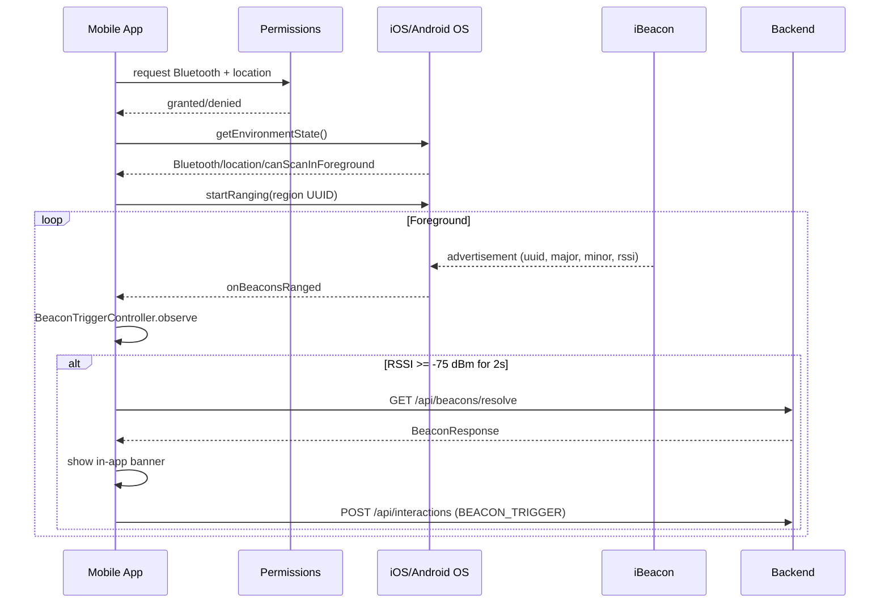
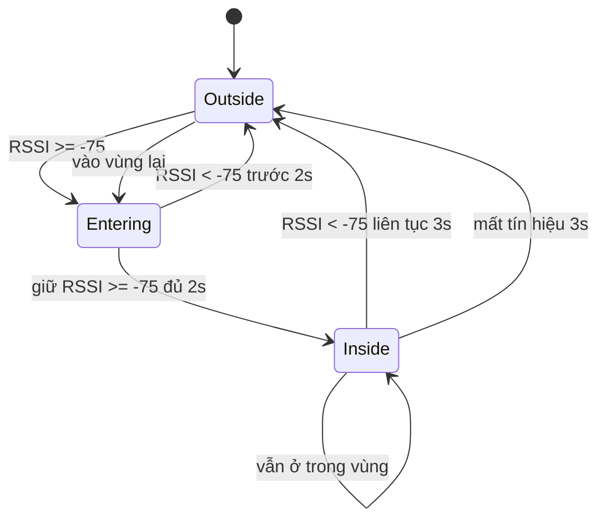

# iBeacon / BLE Flow — LTJ-42

Tài liệu mô tả thiết kế và implementation hiện tại của luồng **iBeacon/BLE** trong Visitor App.

> Trạng thái Wave 4: foreground discovery đã được implement ở mobile và backend. Background scanning, native build trên thiết bị và kiểm chứng phần cứng **chưa được thực hiện**. Xem báo cáo chi tiết tại [`docs/features/ibeacon-mobile-integration.md`](../features/ibeacon-mobile-integration.md).

---

## 1. Công nghệ và thư viện

- **iBeacon**: định danh beacon bằng `proximity UUID + major + minor`.
- **Mobile library**: `react-native-beacon-kit@0.12.0`.
- **Permissions**: `react-native-permissions@5.6.3`.
- **Native build**: bắt buộc. Expo Go không thể kiểm chứng native BLE/iBeacon.

`react-native-beacon-kit` được chọn vì có API ranging iBeacon trực tiếp (`startRanging`, `onBeaconsRanged`, `onRangingFailed`, `getEnvironmentState`) và type definitions. Thư viện có mức độ phổ biến thấp và chưa được xác minh trên thiết bị thật trong wave này; implementation native được cô lập sau `beaconService.ts` để có thể thay thế nếu cần.

---

## 2. Luồng phát hiện



Mobile chỉ quét khi:

- Người dùng bật toggle trên Home.
- App đang ở foreground (`AppState === 'active'`).
- Runtime permissions đã được cấp.
- Bluetooth và location services đang bật.
- `canScanInForeground === true`.

Khi app vào background, scanning dừng và trạng thái chuyển sang `paused`. Khi active lại, app xin lại trạng thái môi trường và bắt đầu quét nếu toggle vẫn bật.

---

## 3. Beacon identity

```text
UUID   = E2C56DB5-DFFB-48D2-B060-D0F5A71096E0 (mặc định, cấu hình qua EXPO_PUBLIC_BEACON_UUID)
Major  = 0..65535
Minor  = 0..65535
```

- Key nội bộ: `uuid:major:minor`, UUID được lowercase và trim.
- Không dùng MAC address làm định danh vì có thể bị randomize trên Android và không có trên iOS.
- Mobile validate UUID/major/minor trước khi gọi API.
- Backend lưu unique constraint trên `(proximity_uuid, major, minor)`.

---

## 4. Beacon → Artifact mapping

Backend dùng bảng `beacon`:

- `beacon_id` PK
- `name`
- `proximity_uuid`
- `major`
- `minor`
- `enabled`
- `artifact_id` nullable FK

Public endpoint:

```http
GET /api/beacons/resolve?uuid={uuid}&major={major}&minor={minor}
```

- Không cần JWT.
- Trả `404` nếu beacon không tồn tại hoặc `enabled = false`.
- Response chứa `beaconId`, `artifactId`, `artifactName`, `siteId`, `siteName`.
- Nếu beacon chưa gán artifact, `artifactId` là `null`; mobile hiển thị thông báo thay vì mở chi tiết.

Admin quản lý beacon qua `/api/admin/beacons` với role `ADMIN`.

---

## 5. Trigger và chống lặp



| Tham số | Giá trị |
|---|---|
| RSSI threshold | `-75 dBm` |
| Entry confirmation | `2000 ms` |
| Exit confirmation | `3000 ms` |
| Stale reset | `3000 ms` |
| Banner auto-dismiss | `8000 ms` |

Quy tắc:

- Chỉ trigger một lần cho mỗi lần vào vùng đã xác nhận.
- Không trigger lặp khi người dùng đứng yên.
- Phải rời vùng đủ lâu rồi vào lại mới trigger tiếp.
- Mỗi beacon được track độc lập.
- Mỗi trigger tạo `eventId` mới; retry cùng một lần ghi dùng lại `eventId`.

Implementation: `mobile/src/services/beacon/trigger.ts`.

---

## 6. UI

`BeaconDiscoveryPanel` trên Home cung cấp:

- Toggle bật/tắt quét.
- Trạng thái: idle, requesting permission, permission denied, Bluetooth off, location off, paused, scanning, error.
- Banner khi phát hiện hiện vật:
  - Tên hiện vật.
  - Tên site hoặc tên beacon.
  - Nút **“Xem chi tiết”**.
  - Nút **“Đóng”**.
- Banner tự đóng sau 8 giây.

Không tự động điều hướng; người dùng chủ động bấm “Xem chi tiết”.

---

## 7. Interaction

Khi resolve thành công và beacon có artifact:

```json
{
  "eventId": "<uuid>",
  "visitorId": "<installation uuid>",
  "artifactId": 42,
  "beaconId": 7,
  "interactionType": "BEACON_TRIGGER",
  "languageCode": "vi",
  "startedAt": "2026-11-07T10:00:00Z",
  "interactedAt": "2026-11-07T10:00:00Z"
}
```

Backend validate:

- `beaconId` bắt buộc với `BEACON_TRIGGER`.
- Beacon phải enabled.
- Beacon phải được gán artifact.
- Artifact của beacon phải khớp `artifactId`.
- Interaction type khác không được gửi `beaconId`.
- Duplicate `eventId` trả interaction hiện có trước khi validate beacon.

---

## 8. Permission và native config

Local Expo config plugin: `mobile/plugins/with-beacon-permissions.js`.

Android:

- `ACCESS_FINE_LOCATION`
- `BLUETOOTH_SCAN`
- `BLUETOOTH_CONNECT`
- `android.hardware.bluetooth_le` (`required=false`)
- Remove các quyền không dùng: background location, Bluetooth advertise, foreground service, foreground service location, notification.

iOS:

- `NSBluetoothAlwaysUsageDescription`
- `NSBluetoothPeripheralUsageDescription`
- `NSLocationWhenInUseUsageDescription`
- `NSLocationAlwaysAndWhenInUseUsageDescription`

Không bật background location hoặc foreground service.

---

## 9. Background scanning

**DEFERRED**:

- Cần foreground service trên Android và background capability/review trên iOS.
- Tăng pin và độ phức tạp vận hành.
- Chưa có acceptance criteria và chưa thể kiểm chứng thiết bị.
- MVP foreground đáp ứng luồng “mở app khi đứng gần hiện vật”.

---

## 10. Kiểm chứng

- Backend unit tests: 120 pass.
- PostgreSQL integration tests: 22 pass, bao gồm Flyway V3.
- Mobile Jest: 81 pass.
- Mobile TypeScript và lint: pass.
- Expo config introspection: permission Android/iOS được áp dụng.
- Native build/device/hardware: **chưa chạy**.

Chi tiết và hướng dẫn test thiết bị: [`docs/features/ibeacon-mobile-integration.md`](../features/ibeacon-mobile-integration.md).
