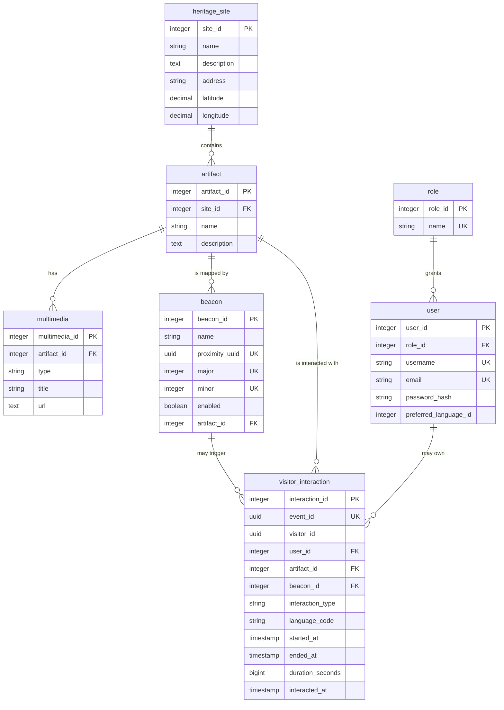

# Smart Heritage — Database ERD and Data Dictionary

Status: **as-built schema after Flyway V4** on PostgreSQL 16.
Source of truth: `backend/src/main/resources/db/migration/V1..V4`.

## 1. ERD

Mermaid cannot express composite unique keys on one line cleanly; the real
constraints are listed below.

## 2. Physical tables

All tables live in schema `public`. Every primary key is an `integer` backed by
a sequence with `nextval(...)` default and `GenerationType.IDENTITY` in JPA.

### 2.1 `heritage_site`

| Column | Type | Null | Default | Notes |
|---|---|---|---|---|
| `site_id` | `integer` | no | `nextval('heritage_site_site_id_seq')` | PK |
| `name` | `varchar(255)` | no | — | Required |
| `description` | `text` | yes | — | Free text |
| `address` | `varchar(500)` | yes | — | Free text |
| `latitude` | `numeric(9,6)` | yes | — | Validated by DTO to `-90..90` |
| `longitude` | `numeric(9,6)` | yes | — | Validated by DTO to `-180..180` |

Constraints/indexes: `heritage_site_pkey (site_id)`.

No `created_at`/`updated_at` auditing columns exist.

### 2.2 `artifact`

| Column | Type | Null | Default | Notes |
|---|---|---|---|---|
| `artifact_id` | `integer` | no | `nextval('artifact_artifact_id_seq')` | PK |
| `site_id` | `integer` | no | — | FK → `heritage_site.site_id` |
| `name` | `varchar(255)` | no | — | Required |
| `description` | `text` | yes | — | Free text |

Constraints/indexes:

- `artifact_pkey (artifact_id)`;
- `fkhgjkmdr8b9rjetwr9rl35ft4w` on `site_id` → `heritage_site(site_id)`.

No explicit index on `site_id` beyond the FK; PostgreSQL does not create one
automatically. The current data volumes do not justify adding one yet.

### 2.3 `multimedia`

| Column | Type | Null | Default | Notes |
|---|---|---|---|---|
| `multimedia_id` | `integer` | no | `nextval('multimedia_multimedia_id_seq')` | PK |
| `artifact_id` | `integer` | no | — | FK → `artifact.artifact_id` |
| `type` | `varchar(20)` | no | — | Stored as submitted; clients normalize `IMAGE`, `AUDIO`, `VIDEO` |
| `title` | `varchar(255)` | yes | — | Optional |
| `url` | `text` | no | — | Media location; the backend does not fetch or validate availability |

Constraints/indexes:

- `multimedia_pkey (multimedia_id)`;
- `fkbyhxyqjwrbcg0ttk6e93mxxc` on `artifact_id` → `artifact(artifact_id)`.

`type` has no database `CHECK`; `MultimediaRequest` enforces non-blank and
`max 20`, and mobile normalizes unknown values to `UNKNOWN`.

### 2.4 `role`

| Column | Type | Null | Default | Notes |
|---|---|---|---|---|
| `role_id` | `integer` | no | `nextval('role_role_id_seq')` | PK |
| `name` | `varchar(50)` | no | — | Unique |

Constraints/indexes: `role_pkey (role_id)`, `uk_8sewwnpamngi6b1dwaa88askk
(name)`.

Current role values used by the application: `ADMIN`, `VISITOR`.
`AuthService.register` creates `VISITOR` on demand if it does not exist. There
is no seed migration for roles or an initial admin account.

### 2.5 `"user"`

The table name is quoted because `user` is a PostgreSQL keyword.

| Column | Type | Null | Default | Notes |
|---|---|---|---|---|
| `user_id` | `integer` | no | `nextval('user_user_id_seq')` | PK |
| `role_id` | `integer` | no | — | FK → `role.role_id` |
| `username` | `varchar(100)` | no | — | Unique |
| `email` | `varchar(255)` | no | — | Unique |
| `password_hash` | `varchar(255)` | no | — | BCrypt hash; never plain text |
| `preferred_language_id` | `integer` | yes | — | Stored value only; **no FK and no language table** |

Constraints/indexes:

- `user_pkey (user_id)`;
- `uk_ob8kqyqqgmefl0aco34akdtpe (email)`;
- `uk_sb8bbouer5wak8vyiiy4pf2bx (username)`;
- `fkdl9dqp078pc03g6kdnxmnlqpc` on `role_id` → `role(role_id)`.

`preferred_language_id` is a forward-looking placeholder. The backend validates
nothing beyond type and the mobile UI does not implement language selection
against a catalogue.

### 2.6 `beacon`

| Column | Type | Null | Default | Notes |
|---|---|---|---|---|
| `beacon_id` | `integer` | no | `nextval('beacon_beacon_id_seq')` | PK |
| `name` | `varchar(255)` | no | — | Admin-facing label |
| `proximity_uuid` | `uuid` | no | — | iBeacon proximity UUID |
| `major` | `integer` | no | — | `0..65535` |
| `minor` | `integer` | no | — | `0..65535` |
| `enabled` | `boolean` | no | `true` | Disabled beacons do not resolve |
| `artifact_id` | `integer` | yes | — | Optional mapping to an artifact |

Constraints/indexes:

- `beacon_pkey (beacon_id)`;
- `uk_beacon_identity (proximity_uuid, major, minor)` — full iBeacon identity;
- `ck_beacon_major_range CHECK (major BETWEEN 0 AND 65535)`;
- `ck_beacon_minor_range CHECK (minor BETWEEN 0 AND 65535)`;
- `fk_beacon_artifact` on `artifact_id` → `artifact(artifact_id)`;
- `idx_beacon_artifact_id (artifact_id)`;
- `enabled` default is normalized by V4 for legacy databases.

The identity deliberately excludes MAC address: Android may randomize it and
iOS does not expose it.

### 2.7 `visitor_interaction`

| Column | Type | Null | Default | Notes |
|---|---|---|---|---|
| `interaction_id` | `integer` | no | `nextval('visitor_interaction_interaction_id_seq')` | PK |
| `event_id` | `uuid` | no | — | Client-generated idempotency key, unique |
| `visitor_id` | `uuid` | no | — | Persistent pseudonymous installation ID |
| `user_id` | `integer` | yes | — | Authenticated owner, if any |
| `artifact_id` | `integer` | no | — | Interacted artifact |
| `beacon_id` | `integer` | yes | — | Present only for `BEACON_TRIGGER` |
| `interaction_type` | `varchar(50)` | no | — | `VIEW`, `AUDIO_PLAY`, `SCAN`, `BEACON_TRIGGER` |
| `language_code` | `varchar(16)` | no | — | BCP-47-like tag, validated by DTO pattern |
| `started_at` | `timestamptz(6)` | no | — | Event start |
| `ended_at` | `timestamptz(6)` | yes | — | Optional |
| `duration_seconds` | `bigint` | yes | — | Derived from `ended_at - started_at` |
| `interacted_at` | `timestamptz(6)` | no | — | Analytics timestamp |

Constraints/indexes:

- `visitor_interaction_pkey (interaction_id)`;
- `uk_visitor_interaction_event_id (event_id)`;
- `fkmtcoqflkohmy8km0j7qkiw64d` on `artifact_id` → `artifact(artifact_id)`;
- `fksovoigajsar5x0lldbs7a9sgs` on `user_id` → `"user"(user_id)`;
- `fk_visitor_interaction_beacon` on `beacon_id` → `beacon(beacon_id)`
  **`ON DELETE SET NULL`**;
- `idx_visitor_interaction_interacted_at (interacted_at)`;
- `idx_visitor_interaction_visitor_id (visitor_id)`;
- `idx_visitor_interaction_beacon_id (beacon_id)`.

No `CHECK` enforces `duration_seconds` or `ended_at >= started_at`; the service
validates the latter. `duration_seconds` is computed in the entity setter, not
by a database trigger.

## 3. Relationship and integrity rules

| Parent | Child | Cardinality | Delete behavior |
|---|---|---|---|
| `heritage_site` | `artifact` | 1 : 0..* | Restrict at service level: delete rejected if artifacts exist |
| `artifact` | `multimedia` | 1 : 0..* | Restrict at service level: delete rejected if multimedia exists |
| `artifact` | `beacon` | 1 : 0..* | Restrict at service level: delete rejected if beacons exist |
| `artifact` | `visitor_interaction` | 1 : 0..* | Restrict at service level: delete rejected if history exists |
| `role` | `"user"` | 1 : 0..* | No cascade configured; role deletion is not exposed |
| `"user"` | `visitor_interaction` | 1 : 0..* | No cascade; `user_id` is nullable |
| `beacon` | `visitor_interaction` | 1 : 0..* | `ON DELETE SET NULL` preserves analytics history |

Important nuances:

- The database FKs for `artifact.site_id`, `multimedia.artifact_id` and
  `beacon.artifact_id` are plain `NO ACTION`/`RESTRICT`-style references. The
  friendly conflict messages come from `ArtifactService` and
  `HeritageSiteService`, not from the database.
- Deleting a `visitor_interaction` row is not exposed by the API.
- `event_id` uniqueness is the final protection against duplicate submissions
  under concurrency; the service performs a pre-check for the normal path and
  `GlobalExceptionHandler` maps the unique-constraint violation to `409` for the
  race path.
- `beacon_id` is allowed only for `BEACON_TRIGGER`; the service also requires
  the beacon to be enabled and mapped to the same artifact as the interaction.

## 4. Migration history

| Version | File | Purpose |
|---|---|---|
| V1 | `V1__baseline_schema.sql` | Original M1/M2 schema: six tables, sequences, PK/FK/unique constraints |
| V2 | `V2__visitor_interaction_anonymous_visitor.sql` | Adds `visitor_id`, backfills it, makes it `NOT NULL`, makes `user_id` nullable, adds analytics indexes |
| V3 | `V3__beacon_management.sql` | Creates `beacon`, adds `visitor_interaction.beacon_id`, identity uniqueness, range checks, indexes, `ON DELETE SET NULL` |
| V4 | `V4__normalize_legacy_schema.sql` | Idempotently reconciles Hibernate-created databases: indexes, `enabled` default, validated range checks, exact beacon FK mapping/action |

Migration rules:

- forward-only; never edit an applied V1–V4 file;
- `baseline-on-migrate=false`, `clean-disabled=true`,
  `validate-on-migrate=true`;
- existing non-empty databases must be classified with
  `scripts/database/detect-schema-version.sql` and explicitly baselined;
- production runs Hibernate with `ddl-auto=validate` only.

See [migration-strategy.md](../../database/migration-strategy.md) and
[schema-baseline.md](../../database/schema-baseline.md).

## 5. Query and index map

| Access path | Query | Supporting index/strategy |
|---|---|---|
| Admin site list with keyword | `HeritageSiteSpecification.hasKeyword` + sort | Small table; no dedicated search index |
| Admin artifact list by site/keyword | `ArtifactSpecification.filter` + sort | FK `site_id`; `name` sort is in memory/database sort |
| Artifact writes / public reads | `findByHeritageSite_SiteId`, `findById` | PK; `@EntityGraph("heritageSite")` avoids lazy N+1 on list reads |
| Multimedia list by artifact | `findByArtifact_ArtifactId` | FK; `@EntityGraph("artifact")` |
| Beacon resolution | `findForResolutionByIdentity` | `uk_beacon_identity`; fetch-joins artifact and site |
| Interaction summary | `countInPeriod`, `countUniqueVisitorsInPeriod` | `idx_visitor_interaction_interacted_at` |
| Interaction by type / language | grouped JPQL | `idx_visitor_interaction_interacted_at` |
| Popular artifacts | grouped JPQL, limit 10 | `idx_visitor_interaction_interacted_at` |
| Daily time series | native PostgreSQL date grouping in UTC | `idx_visitor_interaction_interacted_at` |
| Idempotency lookup | `findByEventId` | unique `uk_visitor_interaction_event_id` |

`VisitorInteractionService` uses concrete wide bounds
(`1970-01-01T00:00:00Z` … `9999-12-31T23:59:59.999Z`) instead of binding `NULL`
for an open range, because PostgreSQL cannot infer the type of a `NULL` JDBC
parameter in `(:param IS NULL OR ...)` predicates.

## 6. Data dictionary conventions and gaps

- Timestamps are `timestamptz`, produced as `Instant` in Java. Analytics day
  buckets use UTC.
- Coordinates use `numeric(9,6)`, not PostGIS geography; no spatial queries are
  implemented.
- There is no audit trail, soft-delete column, version column or optimistic
  locking field.
- There is no translation table. `language_code` is analytics metadata, not a
  content-localization model.
- There are no favorites, feedback or visit-history tables. Those mobile
  features are currently mock/placeholder in code and are therefore not part of
  the schema.
- No seed data is shipped in migrations.

## 7. Related documents

- [System architecture](system-architecture.md)
- [Java backend architecture](java-backend-architecture.md)
- [API overview](api-overview.md)
- [Migration strategy](../../database/migration-strategy.md)
- [Schema baseline](../../database/schema-baseline.md)
- [Database backup/restore acceptance](../database-backup-restore.md)
