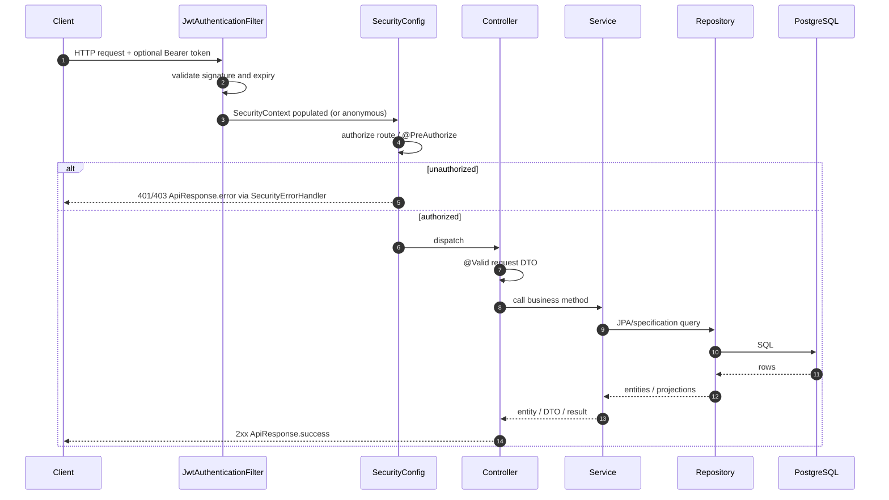
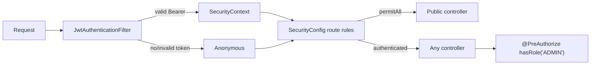

# Smart Heritage — Java Backend Architecture

Status: **as-built** for `backend/` at `main` (`6e11c0b`).
Stack: Java 17, Spring Boot 3.2.5, Spring Data JPA, Spring Security, Flyway,
PostgreSQL 16, JWT (`jjwt` 0.12.5), Maven.

## 1. Package structure

```text
com.university.backend
├── BackendApplication.java
├── config/
│   └── SecurityConfig.java
├── controller/
│   ├── AuthController.java
│   ├── UserController.java
│   ├── HeritageSiteController.java
│   ├── ArtifactController.java
│   ├── MultimediaController.java
│   ├── BeaconController.java
│   ├── AdminBeaconController.java
│   ├── VisitorInteractionController.java
│   └── HealthController.java
├── service/
│   ├── AuthService.java
│   ├── HeritageSiteService.java
│   ├── ArtifactService.java
│   ├── MultimediaService.java
│   ├── BeaconService.java
│   └── VisitorInteractionService.java
├── repository/
│   ├── UserRepository.java
│   ├── RoleRepository.java
│   ├── HeritageSiteRepository.java
│   ├── ArtifactRepository.java
│   ├── MultimediaRepository.java
│   ├── BeaconRepository.java
│   ├── VisitorInteractionRepository.java
│   └── DailyInteractionProjection.java
├── specification/
│   ├── HeritageSiteSpecification.java
│   └── ArtifactSpecification.java
├── entity/
│   ├── User.java
│   ├── Role.java
│   ├── HeritageSite.java
│   ├── Artifact.java
│   ├── Multimedia.java
│   ├── Beacon.java
│   └── VisitorInteraction.java
├── dto/                    request/response records and classes
├── exception/              domain exceptions + GlobalExceptionHandler
└── security/
    ├── CustomUserDetailsService.java
    ├── JwtAuthenticationFilter.java
    ├── JwtTokenProvider.java
    └── SecurityErrorHandler.java
```

The package structure is the architecture: controllers do HTTP mapping, services
own business rules and transactions, repositories own persistence queries,
entities are the mapping model, and DTOs isolate the API contract from JPA
entities.

## 2. Layering rules

| Layer | May depend on | Must not do |
|---|---|---|
| `controller` | `service`, `dto`, `entity` (to build responses), `exception` | Contain business rules, call repositories directly, open transactions |
| `service` | `repository`, `entity`, `dto` (analytics responses), `exception`, `specification` | Know HTTP status codes or servlet details |
| `repository` | `entity`, `dto` projections | Contain business decisions |
| `entity` | Jakarta Persistence only | Depend on controllers/services/DTOs |
| `security` | `repository`, `entity`, `dto` | Leak raw credentials/tokens to logs |
| `exception` | `dto` | Expose stack traces or SQL to clients |

Controllers never return bare entities; they wrap DTOs in `ApiResponse<T>`.
The exceptions to "controllers don't use entities" are `ArtifactController`,
`MultimediaController`, `HeritageSiteController` and `BeaconController`, which
construct an entity, pass it to the service, and convert the returned entity to
a DTO via `fromEntity(...)`.

## 3. Request lifecycle in code



### 3.1 Controller conventions

- Class-level `@RequestMapping` for resource collections; method-level mapping
  for operations.
- `@Valid` on request bodies; Jakarta Bean Validation annotations on DTOs.
- `@PreAuthorize("hasRole('ADMIN')")` on every write endpoint and analytics
  endpoint.
- `ResponseEntity` used to control status: `201` on create, `200` otherwise,
  `200` with a different message when an idempotent interaction is replayed.
- The list endpoints support both legacy list mode and paged mode:
  `page`/`size` absent → plain list; present → `PageResponse<T>`.
- Public interaction creation accepts `@AuthenticationPrincipal UserDetails`
  and handles the null principal explicitly.

### 3.2 Service conventions

- `@Service` classes are constructor-injected; no field injection.
- Read methods use `@Transactional(readOnly = true)`.
- Write methods use `@Transactional`.
- Validation that is not expressible in Bean Validation lives in the service:
  - pagination bounds: `page >= 0`, `1 <= size <= 100`;
  - allowed sort fields: `name`, `artifactId` / `name`, `siteId`;
  - `siteId` must exist when supplied;
  - delete guards for dependent rows;
  - beacon identity uniqueness, enabled/mapped/artifact-consistency rules;
  - interaction time ordering;
  - analytics range pairing and maximum 90 days.
- Exceptions used: `BadRequestException` (400), `ResourceNotFoundException`
  (404), `DuplicateResourceException` (409), `ResourceConflictException` (409),
  `BadCredentialsException` (401).

## 4. Domain model and JPA mapping

| Entity | Table | Key mapping notes |
|---|---|---|
| `User` | `"user"` | `@ManyToOne(EAGER)` role; unique username/email; BCrypt hash field |
| `Role` | `role` | Unique name; `ADMIN`/`VISITOR` |
| `HeritageSite` | `heritage_site` | `BigDecimal` coordinates, `numeric(9,6)` |
| `Artifact` | `artifact` | `@ManyToOne(LAZY, optional=false)` to site |
| `Multimedia` | `multimedia` | `@ManyToOne(LAZY, optional=false)` to artifact |
| `Beacon` | `beacon` | `UUID` proximity identity, nullable artifact, unique tuple |
| `VisitorInteraction` | `visitor_interaction` | nullable `user`/`beacon`, required `artifact`, unique `eventId`, `Instant` timestamps |

Notable implementation details:

- `VisitorInteraction.setEndedAt(...)` computes `durationSeconds` from
  `Duration.between(startedAt, endedAt)`. There is no database trigger, so any
  non-JPA writer must maintain the value itself.
- No bidirectional collections are mapped on entities. Queries use repository
  methods and explicit fetch joins; this avoids cascade surprises and keeps the
  object graph small.
- `GenerationType.IDENTITY` matches the PostgreSQL sequences created by V1/V3.
- `spring.jpa.hibernate.ddl-auto=validate` in every non-test profile; Hibernate
  never creates or alters production tables.

## 5. Repository and query strategy

| Repository | Key methods | Why |
|---|---|---|
| `HeritageSiteRepository` | `JpaRepository`, `JpaSpecificationExecutor` | keyword filter and paged reads |
| `ArtifactRepository` | `findAll(spec, sort/pageable)`, `findByHeritageSite_SiteId`, `existsByHeritageSite_SiteId` | filtered paging, delete guard |
| `MultimediaRepository` | `findAll`, `findByArtifact_ArtifactId`, `existsByArtifact_ArtifactId` | list and delete guard |
| `BeaconRepository` | `findByProximityUuidAndMajorAndMinor`, `findForResolutionByIdentity`, `existsByArtifact_ArtifactId` | uniqueness check, public resolution |
| `VisitorInteractionRepository` | `findByEventId`, five analytics queries, `existsByArtifact_ArtifactId` | idempotency, analytics, delete guard |
| `UserRepository`/`RoleRepository` | username/email lookups, existence checks | auth and registration |

### 5.1 N+1 avoidance

- `ArtifactRepository.findAll(spec, ...)` overrides both overloads with
  `@EntityGraph(attributePaths = "heritageSite")` so `ArtifactResponse` can read
  `siteId`/`siteName` without one query per artifact.
- `MultimediaRepository.findAll` and `findByArtifact_ArtifactId` use
  `@EntityGraph(attributePaths = "artifact")` so `MultimediaResponse` can read
  the artifact name.
- `BeaconRepository.findForResolutionByIdentity` uses `LEFT JOIN FETCH` for the
  artifact and its heritage site in one query.
- There is no global `hibernate.default_batch_fetch_size`; the explicit fetch
  graphs are the chosen mechanism.

### 5.2 Specifications

`HeritageSiteSpecification.hasKeyword` and `ArtifactSpecification.filter` build
`LIKE lower(...)` predicates with trimmed/lowercased input. Artifact filtering
supports `siteId` and case-insensitive artifact name. Sorting is allow-listed in
the service to prevent arbitrary property injection; a deterministic tie-breaker
(`artifactId` or `siteId`) is always appended.

### 5.3 Analytics queries

- JPQL constructor expressions map directly to records:
  `InteractionTypeCountResponse`, `PopularArtifactResponse`,
  `LanguageCountResponse`.
- Popular artifacts are limited to 10 via `PageRequest.of(0, 10)`.
- Daily series uses a native PostgreSQL query
  `CAST(interacted_at AT TIME ZONE 'UTC' AS DATE)` and a projection interface
  `DailyInteractionProjection`.
- `getDailyTimeSeries` zero-fills missing calendar days between the requested
  bounds, so the client receives a continuous series.
- Language counts merge `null`/blank codes into `UNKNOWN` and sort by count
  descending, then code.

## 6. Transactions and concurrency

| Operation | Transaction | Concurrency behavior |
|---|---|---|
| Public reads | `readOnly=true` | MVCC reads |
| Create/update/delete content | write transaction | last-write-wins; no `@Version` optimistic lock |
| Interaction insert | write transaction | unique `event_id` is the final duplicate guard |
| Interaction replay | `findByEventId` pre-check | same identity → 200 replay; different identity → 409 |
| Beacon create/update | write transaction | service uniqueness pre-check + DB unique constraint |
| Analytics | `readOnly=true` | consistent snapshot per query |

Race handling:

1. Two identical interactions arrive concurrently.
2. Both may pass `findByEventId` before either commits.
3. The database rejects the second insert with
   `uk_visitor_interaction_event_id`.
4. `GlobalExceptionHandler` catches `DataIntegrityViolationException`, checks
   the normalized message for that constraint name, and returns `409` with a
   user-safe message.

The same pattern applies to `uk_beacon_identity`. Generic integrity violations
are logged with the exception and returned as `500` without leaking SQL.

There is no distributed transaction, outbox or event bus; every business action
is a single database transaction.

## 7. Validation and error handling

### 7.1 DTO validation

| DTO | Rules |
|---|---|
| `RegisterRequest` | username 3–100, valid email ≤255, password 6–100 |
| `LoginRequest` | username/password non-blank |
| `UpdateProfileRequest` | optional username 3–100, optional language ID |
| `HeritageSiteRequest` | name non-blank ≤255, address ≤500, latitude −90..90, longitude −180..180 |
| `ArtifactRequest` | positive `siteId`, name non-blank ≤255 |
| `MultimediaRequest` | positive `artifactId`, non-blank type ≤20, non-blank url, title ≤255 |
| `BeaconRequest` | name non-blank ≤255, UUID/major/minor required, major/minor 0..65535, positive optional artifact ID |
| `CreateInteractionRequest` | UUID event/visitor, positive artifact, optional positive beacon, type pattern, language pattern ≤16, required instants |

`@Validated` on `BeaconController` enables method-parameter validation for the
public resolution query parameters (`@Min/@Max`).

### 7.2 Exception mapping

| Exception | HTTP | Envelope message |
|---|---|---|
| `MethodArgumentNotValidException` | 400 | `Request validation failed` + field errors |
| `ConstraintViolationException` | 400 | `Request validation failed` + field errors |
| `HttpMessageNotReadableException` | 400 | `Malformed request body` |
| `MissingServletRequestParameterException` | 400 | `Missing required request parameter: <name>` |
| `MethodArgumentTypeMismatchException` | 400 | `Invalid request parameter: <name>` |
| `BadRequestException` | 400 | domain message |
| `ResourceNotFoundException` | 404 | domain message |
| `NoResourceFoundException` | 404 | `Resource not found` |
| `DuplicateResourceException` | 409 | domain message |
| `ResourceConflictException` | 409 | domain message |
| `DataIntegrityViolationException` | 409 or 500 | mapped only for known unique constraints |
| `BadCredentialsException` | 401 | `Invalid username or password` |
| `AccessDeniedException` | 403 | generic permission message |
| anything else | 500 | `An unexpected error occurred` |

`SecurityErrorHandler` independently writes the same envelope for 401/403 that
occur inside the filter chain, because those happen before `@RestControllerAdvice`
can run.

## 8. Security implementation



- `JwtTokenProvider` creates a signed token with subject = username and claim
  `role`. It reads `app.jwt.secret` and `app.jwt.expiration-ms`.
- `JwtAuthenticationFilter` ignores malformed/expired tokens silently and lets
  the authorization rules produce 401. It never logs the raw token.
- `CustomUserDetailsService` maps the persisted role name to
  `ROLE_<name>`, which is what `hasRole('ADMIN')` expects.
- `PasswordEncoder` is `BCryptPasswordEncoder`.
- CSRF is disabled and sessions are stateless; the API is token-based and does
  not use cookies.
- CORS is configured for `/api/**` from `app.cors.allowed-origins`
  (`CORS_ALLOWED_ORIGINS`), methods GET/POST/PUT/PATCH/DELETE/OPTIONS, headers
  `Authorization`, `Content-Type`, `Accept`, credentials disabled.

### Route permission matrix

| Route | Rule |
|---|---|
| `/api/health` | permitAll |
| `/api/auth/**` | permitAll |
| `GET /api/heritage-sites/**` | permitAll |
| `GET /api/artifacts/**` | permitAll |
| `GET /api/multimedia/**` | permitAll |
| `GET /api/beacons/**` | permitAll |
| `POST /api/interactions` | permitAll |
| `OPTIONS /**` | permitAll |
| `/api/admin/**` | authenticated + method `ADMIN` |
| `/api/analytics/**` | authenticated + method `ADMIN` |
| `/api/users/**` | authenticated |
| all other writes on content/beacon resources | authenticated + method `ADMIN` |

## 9. Configuration

| File | Purpose |
|---|---|
| `application.yml` | PostgreSQL datasource, Flyway, JPA `validate`, server port, JWT and CORS env fallbacks |
| `application-prod.yml` | `show-sql=false`, `format_sql=false`, `open-in-view=false`, graceful shutdown, 25 s phase timeout |
| `src/test/resources/application-test.yml` | H2 test profile |
| `src/test/resources/application-postgres-test.yml` | real PostgreSQL integration profile |

Flyway settings: `enabled=true`, `baseline-on-migrate=false`,
`baseline-version=3`, `validate-on-migrate=true`, `clean-disabled=true`,
`out-of-order=false`.

### Environment variables

| Variable | Default | Notes |
|---|---|---|
| `SPRING_DATASOURCE_URL` | `jdbc:postgresql://localhost:5432/smart_heritage` | Compose uses `postgres` host |
| `SPRING_DATASOURCE_USERNAME` / `PASSWORD` | `postgres` / `postgres` | dev fallback only |
| `SERVER_PORT` | `8080` | |
| `JWT_SECRET` | dev-only string | must be ≥256 bits outside local dev |
| `JWT_EXPIRATION_MS` | `86400000` | |
| `CORS_ALLOWED_ORIGINS` | `http://localhost:5173,http://localhost:8081` | comma-separated |
| `SPRING_PROFILES_ACTIVE` | — | `prod` in production Compose |

## 10. Testing architecture

Unit/slice tests (H2, `./mvnw test`):

| Area | Test classes |
|---|---|
| Application context | `BackendApplicationTests` |
| Controllers | `AuthControllerTest`, `ArtifactControllerTest`, `HeritageSiteControllerTest`, `MultimediaControllerTest`, `BeaconControllerTest`, `BeaconResolveValidationTest`, `VisitorInteractionControllerTest`, `PublicContentAccessTest`, `CorsIntegrationTest` |
| Services | `BeaconServiceTest`, `VisitorInteractionServiceTest` |
| Error mapping | `GlobalExceptionHandlerTest` |
| Shared fixtures | `ContentApiTestSupport` |

PostgreSQL integration tests (Failsafe, profile `postgres-integration`):

| Class | Focus |
|---|---|
| `VisitorInteractionPostgresIT` | interaction persistence, idempotency, analytics on real PostgreSQL |
| `DatabaseMigrationIT` | V1–V4 migration and normalization |
| `SchemaDetectorIT` | schema classification script |
| `ArtifactQueryOptimizationIT` | fetch graph/query behavior |
| `BeaconResolutionIntegrityIT` | beacon identity, FK action, resolution |

CI enforces minimum test counts for these five classes in
`.github/workflows/ci.yml`. H2 tests are not evidence of PostgreSQL migration
behavior.

## 11. Build and packaging

- Maven wrapper (`./mvnw`) with Spring Boot parent 3.2.5.
- `./mvnw test` for unit tests; `./mvnw -Ppostgres-integration verify` for
  integration tests against a real PostgreSQL.
- `backend/Dockerfile` is multi-stage: Maven build (tests included) →
  `eclipse-temurin:17-jre` runtime, non-root user, `curl` health check.
- The runtime image contains only the jar, not Maven or the source tree.

## 12. Extension rules for future work

1. Add schema changes as a new `V5__...sql`; never edit V1–V4.
2. Add a migration test on PostgreSQL when changing constraints or indexes.
3. Put HTTP concerns in controllers, rules in services, queries in repositories.
4. Add a DTO for any new request/response; do not expose entities.
5. Annotate new write/analytics endpoints with explicit authorization.
6. Add a delete guard if a new table points at existing content.
7. Keep the API envelope and existing path prefix `/api`.
8. Document any new placeholder honestly; do not describe planned features as
   implemented.
