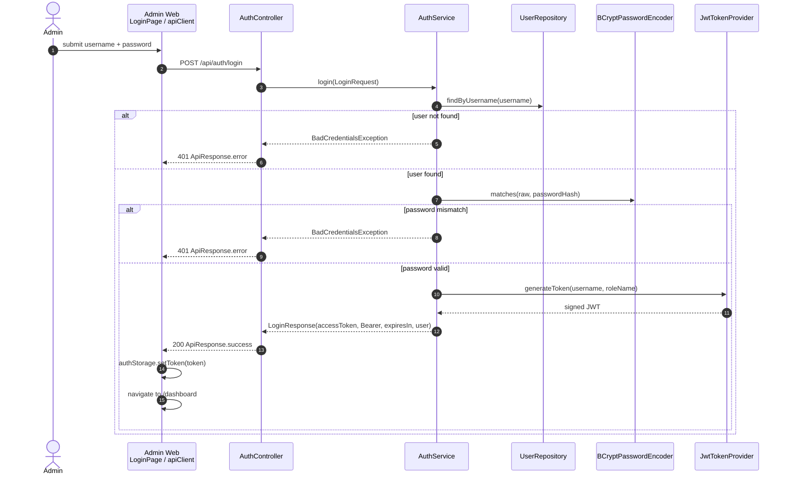
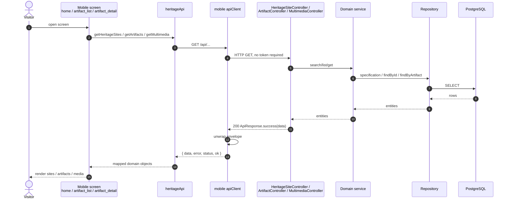
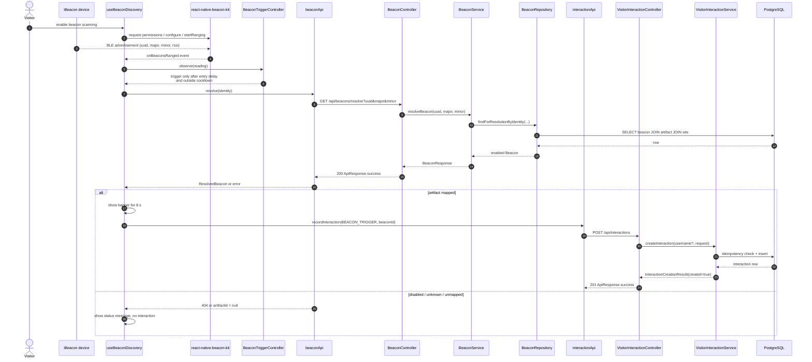
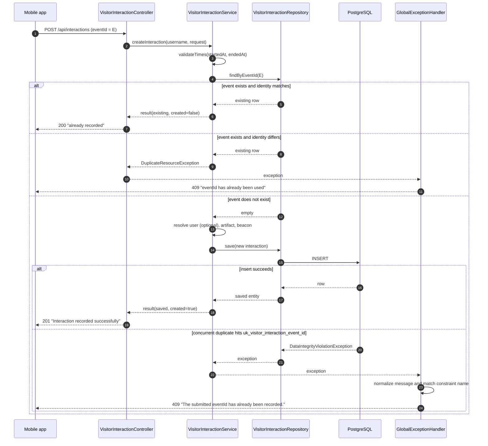
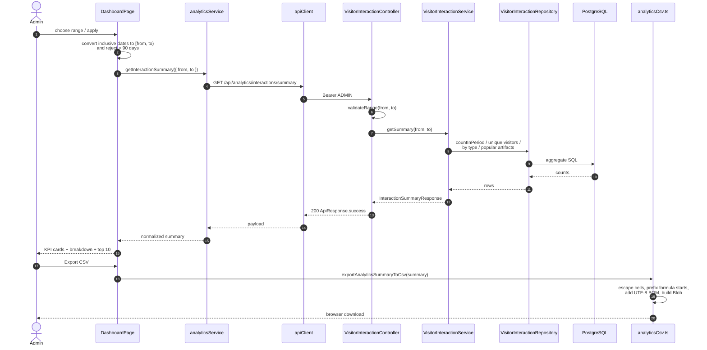
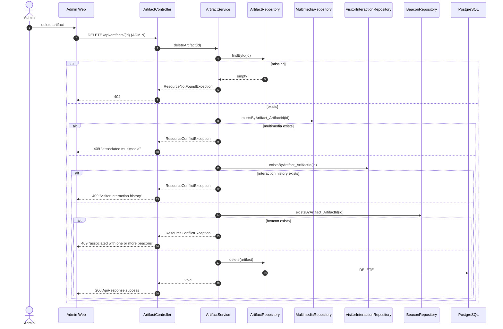
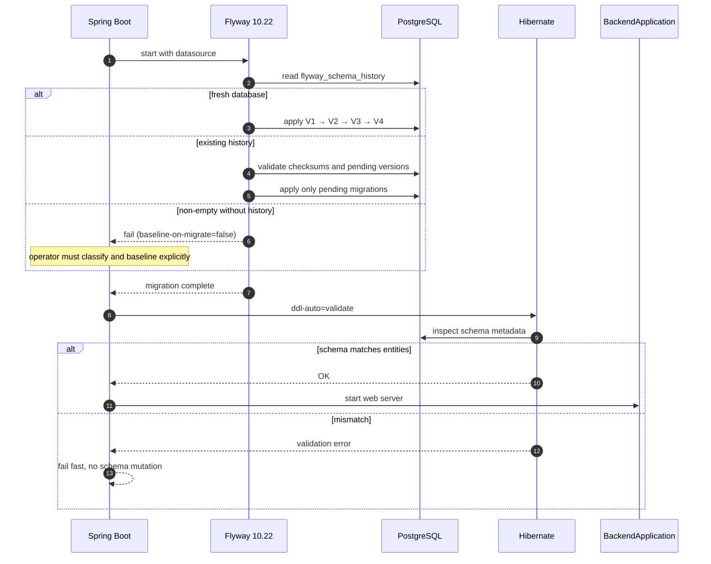

# Smart Heritage — Sequence Diagrams

These diagrams describe the behavior implemented at `main` (`6e11c0b`). They
use participant names from the actual classes and paths from the controllers.

## 1. Admin login and protected request



Protected admin request:

```mermaid
sequenceDiagram
    autonumber
    participant Web as Admin Web
    participant Filter as JwtAuthenticationFilter
    participant Provider as JwtTokenProvider
    participant Details as CustomUserDetailsService
    participant Security as SecurityConfig
    participant Ctrl as ArtifactController
    participant Svc as ArtifactService
    participant Repo as ArtifactRepository
    participant DB as PostgreSQL

    Web->>Filter: POST /api/artifacts<br/>Authorization: Bearer <jwt>
    Filter->>Provider: validateToken(token)
    Provider-->>Filter: true / false
    alt valid
        Filter->>Provider: getUsernameFromToken(token)
        Filter->>Details: loadUserByUsername(username)
        Details-->>Filter: UserDetails + ROLE_ADMIN
        Filter->>Filter: SecurityContextHolder.setAuthentication(...)
        Filter->>Security: continue chain
        Security->>Security: route match + @PreAuthorize hasRole('ADMIN')
        Security->>Ctrl: dispatch
        Ctrl->>Ctrl: @Valid ArtifactRequest
        Ctrl->>Svc: createArtifact(entity, siteId)
        Svc->>Repo: findById site / save artifact
        Repo->>DB: SQL transaction
        DB-->>Repo: persisted row
        Repo-->>Svc: Artifact
        Svc-->>Ctrl: Artifact
        Ctrl-->>Web: 201 ApiResponse.success(ArtifactResponse)
    else invalid or missing
        Filter->>Security: continue as anonymous
        Security-->>Web: 401 or 403 via SecurityErrorHandler
    end
```

## 2. Public content browsing



The mobile client attaches its Bearer token when one exists, but these GET
routes are `permitAll`; an expired token does not block public content.

## 3. Beacon detection, resolution and interaction recording



The debounce thresholds are mobile constants:
`RSSI >= -75`, entry delay 2 s, exit delay 3 s, stale delay 3 s and a 60 s
cooldown per beacon identity. Android requires location permission (and
Bluetooth scan/connect on API 31+); iOS requires location and Bluetooth.

## 4. Idempotent interaction recording and race handling



Identity for replay detection:

- authenticated event: same username, visitor ID may differ after reinstall;
- anonymous event: no user and the same `visitorId`.

The database unique constraint is the authoritative guard. The service pre-check
only provides a friendly path and avoids unnecessary insert attempts.

## 5. Analytics summary and CSV export



The CSV is generated entirely in the browser from the already-loaded summary.
No backend report endpoint is called, and no PDF/Excel export exists.

## 6. Admin delete with dependent-row guard



Heritage-site deletion follows the same pattern with one guard:
`ArtifactRepository.existsByHeritageSite_SiteId`.

Beacon deletion has no guard: `visitor_interaction.beacon_id` is
`ON DELETE SET NULL`, so analytics history is preserved.

## 7. Startup, Flyway and schema validation



This sequence is the reason a failed deployment is visible rather than silently
"fixed" by Hibernate.

## 8. Related documents

- [System architecture](system-architecture.md)
- [Java backend architecture](java-backend-architecture.md)
- [API overview](api-overview.md)
- [Database ERD](database-erd.md)
- [Requirements traceability](requirements-traceability.md)
