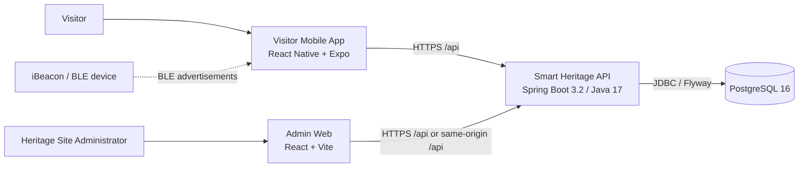
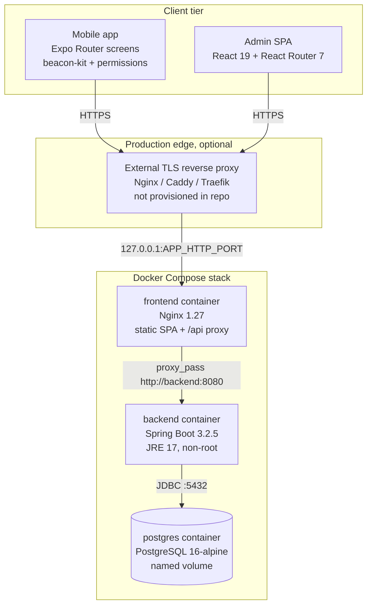
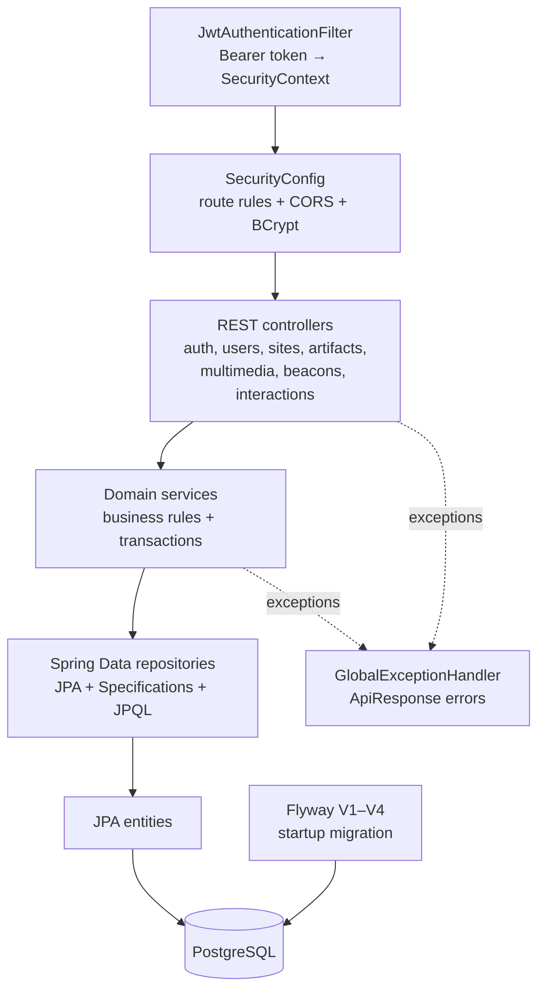

# Smart Heritage — System Architecture

Status: **as-built documentation of `main` at `6e11c0b` (2026-11-20)**.
Scope: S6-M1-03. This document describes the architecture that exists in the
repository. It does not claim that a production environment is deployed.

## 1. Purpose and reading guide

Smart Heritage is a client–server system with two clients, one Spring Boot
backend and one PostgreSQL database:

- a React Native / Expo mobile application for visitors;
- a React + Vite web application for administrators;
- a Java 17 Spring Boot REST API;
- PostgreSQL 16, owned by Flyway migrations.

The backend is a **modular monolith**. It is not a microservice system, and the
current database is the single source of truth for heritage content, beacon
metadata, accounts and visitor interactions.

Use this document together with:

- [Java backend architecture](java-backend-architecture.md) for package and layer
  detail;
- [Database ERD](database-erd.md) for the physical data model;
- [API overview](api-overview.md) for endpoint contracts;
- [Architecture decisions](architecture-decisions.md) for rationale and
  trade-offs;
- [Requirements traceability](requirements-traceability.md) for the honest
  implemented/partial/planned matrix.

## 2. Architectural style

| Concern | Decision |
|---|---|
| Backend style | Modular monolith (single Spring Boot deployment) |
| Client integration | REST over HTTP(S), JSON envelope `ApiResponse<T>` |
| Authentication | Stateless JWT Bearer tokens |
| Authorization | Role-based (`ROLE_ADMIN`, `ROLE_VISITOR`) |
| Persistence | PostgreSQL 16 via Spring Data JPA; schema owned by Flyway |
| Admin delivery | Static Vite build served by Nginx, `/api` reverse-proxied |
| Mobile delivery | Expo application; native BLE scanning through `react-native-beacon-kit` |
| Packaging | Docker images for backend and frontend; Compose for dev and production |
| Public exposure | Only the frontend Nginx port in the production Compose stack |

There is no message broker, cache, search engine, object storage or external
identity provider in the current implementation.

## 3. System context



External actors:

- **Visitor** uses the mobile app. Registration/login is optional for browsing
  and interaction recording; anonymous visitors are supported.
- **Administrator** uses the Admin Web. Every admin page requires a JWT whose
  role is `ADMIN`.
- **iBeacon device** is not a network client. It only broadcasts BLE identity
  (`proximity_uuid`, `major`, `minor`); the phone resolves that tuple through
  the backend.

## 4. Container view



Container responsibilities:

| Container | Runtime | Responsibility |
|---|---|---|
| `frontend` | `nginx:1.27-alpine` | Serves the built SPA, SPA fallback, security headers, gzip, `/healthz`, `/api/` proxy |
| `backend` | `eclipse-temurin:17-jre`, user `app` (UID 10001) | REST API, validation, security, transactions, Flyway on startup, health endpoint |
| `postgres` | `postgres:16-alpine` | Persistent relational data, `pg_isready` health check |

Production-specific properties:

- Compose project `smart-heritage-production` isolates the production volume and
  network from development.
- `backend` and `postgres` publish **no host ports**.
- `frontend` binds `${APP_BIND_ADDRESS:-127.0.0.1}:${APP_HTTP_PORT:-8080}`.
- `SPRING_PROFILES_ACTIVE=prod` disables SQL logging and open-in-view and
  enables graceful shutdown.
- Log rotation is `json-file` with `10m × 3` for all three services.

## 5. Backend component view



Backend modules by responsibility:

| Module | Code | Implemented responsibility |
|---|---|---|
| Auth & user | `AuthController`, `UserController`, `AuthService`, `security/*` | Register, login, JWT issuance/validation, `/users/me`, profile update, role claim |
| Heritage content | `HeritageSiteController`, `ArtifactController`, `MultimediaController`, services, specifications | Public reads; admin CRUD; keyword search; pagination; referential delete guards |
| Beacon | `BeaconController`, `AdminBeaconController`, `BeaconService` | Public beacon resolution by UUID/major/minor; admin CRUD; unique identity and range checks |
| Visitor interaction | `VisitorInteractionController`, `VisitorInteractionService`, `VisitorInteractionRepository` | Public idempotent event recording; admin summary, daily time series and language analytics |
| Cross-cutting | `GlobalExceptionHandler`, `SecurityErrorHandler`, `ApiResponse` | Uniform error envelope, validation errors, 401/403/404/409/500 mapping |

Detailed package rules are in
[Java backend architecture](java-backend-architecture.md).

## 6. Request lifecycle

### 6.1 Authenticated admin request

1. Nginx serves the SPA and proxies `/api/*` to `backend:8080`.
2. `JwtAuthenticationFilter` extracts `Authorization: Bearer <token>`.
3. `JwtTokenProvider` verifies the HMAC signature and expiry.
4. `CustomUserDetailsService` loads the user and maps the role to
   `ROLE_<name>`.
5. `SecurityConfig` enforces the route rule; method security enforces
   `@PreAuthorize("hasRole('ADMIN')")` on writes and analytics.
6. The controller delegates to a service; `@Transactional` bounds the unit of
   work.
7. The service returns an entity/DTO; the controller wraps it in
   `ApiResponse.success(...)`.
8. Exceptions are translated by `GlobalExceptionHandler` into the same
   envelope with `success=false`.
9. `SecurityErrorHandler` handles failures raised inside the filter chain
   (401/403) before a controller is reached.

### 6.2 Public visitor read

`GET /api/heritage-sites`, `/api/artifacts`, `/api/multimedia` and
`/api/beacons/resolve` are explicitly permitted. Writes remain protected by
method security, so a public reader cannot create content.

### 6.3 Anonymous interaction recording

`POST /api/interactions` is public. The controller reads an optional
authenticated principal:

- authenticated: the service resolves the user by username and stores
  `user_id`;
- anonymous: `user_id` stays `NULL`, but `visitor_id` (a persistent
  installation UUID generated on the device) is mandatory.

`event_id` is unique. Re-submitting the same `eventId` with the same identity is
idempotent and returns `200`; reusing it with a different identity returns
`409`.

## 7. Data architecture summary

The physical model is documented in [database-erd.md](database-erd.md).

Core relationships:

```text
heritage_site 1 ─── * artifact 1 ─── * multimedia
                          │
                          ├── * beacon.artifact_id (nullable)
                          └── * visitor_interaction.artifact_id (required)

role 1 ─── * "user" 1 ─── * visitor_interaction.user_id (nullable)

beacon 1 ─── * visitor_interaction.beacon_id (nullable, ON DELETE SET NULL)
```

Key invariants:

- `visitor_interaction.event_id` is globally unique (idempotency key).
- `visitor_interaction.visitor_id` is `NOT NULL`; `user_id` is nullable.
- `beacon (proximity_uuid, major, minor)` is unique; `major` and `minor` are
  constrained to `0..65535`.
- Deleting a beacon does not delete interaction history; `beacon_id` becomes
  `NULL`.
- Heritage sites and artifacts are protected by service-level delete guards
  when dependent rows exist. The schema does not cascade those deletes.

## 8. Security architecture

| Control | Implementation |
|---|---|
| Password storage | BCrypt via `BCryptPasswordEncoder` |
| Token format | Signed JWT (HS256 class of HMAC key, `jjwt` 0.12.5) |
| Token TTL | `JWT_EXPIRATION_MS`, default `86400000` (24 h) |
| Session | `SessionCreationPolicy.STATELESS`; CSRF disabled because no cookies are used |
| Public routes | `/api/health`, `/api/auth/**`, GET content/beacon reads, `POST /api/interactions`, `OPTIONS /**` |
| Protected routes | Everything else; admin writes and analytics use `@PreAuthorize` |
| CORS | Explicit origin list, methods GET/POST/PUT/PATCH/DELETE/OPTIONS, headers `Authorization`, `Content-Type`, `Accept`; credentials disabled |
| Error responses | Generic messages; unexpected exceptions log server-side and return `An unexpected error occurred` |
| Transport | TLS termination is delegated to an external reverse proxy; HSTS/CSP are not set inside Nginx |
| Container | Backend runs as non-root UID 10001 |

Known security limitations, preserved from the release audit:

- no login rate limiting or account lockout;
- no refresh-token rotation or revocation list;
- JWT is valid until expiry after logout on the client (client-side token
  deletion only);
- no CSP/HSTS in the container; external proxy is responsible for TLS/HSTS;
- Nginx master process still runs as root inside the official image.

## 9. Deployment architecture and environments

### 9.1 Development

`docker-compose.yml` runs `postgres` and `backend` with published ports
`5432` and `8080`. The Admin Web and mobile app normally run on the host
(`npm run dev`, `expo start`) and call `http://localhost:8080/api`. Development
secrets fall back to documented local-only values.

### 9.2 Production packaging

`docker-compose.production.yml` is a three-service stack with:

- required environment variables enforced with `${VAR:?message}`;
- `SPRING_PROFILES_ACTIVE=prod`;
- `SPRING_JPA_HIBERNATE_DDL_AUTO=validate`;
- Flyway enabled, automatic baseline disabled;
- frontend same-origin `/api` proxy by default (`VITE_API_BASE_URL` empty);
- health checks on all services and `restart: unless-stopped`.

This stack is exercised by CI `production-smoke` on an ephemeral host. It has
**not** been deployed to a real server: domain, DNS, TLS certificate, registry
push and production credentials are still pending.

### 9.3 Environment differences

| Concern | Development | Production Compose |
|---|---|---|
| Exposed ports | PostgreSQL 5432, backend 8080 | frontend loopback only |
| SQL logging | enabled (`show-sql=true`, formatted) | disabled |
| `open-in-view` | default (enabled) | `false` |
| Shutdown | `stop_grace_period: 30s` | graceful, 25 s phase timeout, 30 s stop grace |
| Secrets | documented dev fallbacks | required env vars, must differ from dev |
| Database | local volume | named production volume |

## 10. Cross-cutting operational behavior

- **Health**: `GET /api/health` returns `{"status":"UP","timestamp":...}`.
  Backend and Compose health checks use it. Nginx exposes `/healthz` returning
  `ok` for the frontend container.
- **Startup**: Flyway applies V1–V4 in order, then Hibernate validates. A
  schema mismatch fails startup instead of mutating the database.
- **Backup/restore**: see
  [database-backup-restore.md](../database-backup-restore.md) and
  [backup-restore.md](../../deployment/backup-restore.md). CI runs a disposable
  PostgreSQL 16 round trip.
- **Observability**: application logs to stdout/stderr, Docker log rotation,
  no Prometheus/Grafana/ELK in scope, no centralized tracing.
- **Graceful shutdown**: Spring finishes in-flight requests for up to 25 s;
  Compose allows 30 s before `SIGKILL`.

## 11. Implemented scope versus placeholders

The architecture must be read together with the honest feature inventory:

| Capability | Status |
|---|---|
| Admin authentication and ADMIN guard | Implemented |
| Heritage site, artifact, multimedia admin CRUD | Implemented |
| Beacon admin CRUD and public resolution | Implemented |
| Interaction recording and analytics summary/time series/languages | Implemented |
| Admin analytics dashboard and client-side CSV export | Implemented |
| Mobile login/register, site list, artifact list/detail, multimedia playback | Implemented against real API |
| Mobile iBeacon scan → resolve → banner → interaction | Implemented in code; physical-device verification pending |
| Mobile Heritage Map | Placeholder screen |
| Mobile Feedback | Placeholder screen with a local alert only |
| Mobile Favorites / Visit History | Mock data, no persistence or backend API |
| Admin Translations / Feedback pages | Placeholder pages |
| Multilingual content storage | Not implemented; `language_code` is recorded per interaction only |
| PDF/Excel report export | Not implemented; CSV export is client-side |
| Production deployment, domain, TLS | Pending |

## 12. Explicit non-goals and limitations

- No microservices, event streaming or distributed transactions.
- No offline-first synchronization protocol; the mobile app retries individual
  interaction events and tolerates network failure without blocking content.
- No physical beacon management beyond metadata/identity mapping.
- No real-device iOS/Android BLE, audio/video playback or store signing evidence
  in this repository.
- No production monitoring, alerting or autoscaling.

## 13. Related documents

- [Database ERD](database-erd.md)
- [Java backend architecture](java-backend-architecture.md)
- [API overview](api-overview.md)
- [Use case diagram](use-case-diagram.puml)
- [Sequence diagrams](sequence-diagrams.md)
- [Backend class diagram](backend-class-diagram.puml)
- [Architecture decisions](architecture-decisions.md)
- [Java defense guide](java-defense-guide.md)
- [Requirements traceability](requirements-traceability.md)
- [Release readiness](../release-readiness.md)
- [Database backup/restore acceptance](../database-backup-restore.md)
- [Production deployment](../../deployment/production-deployment.md)
